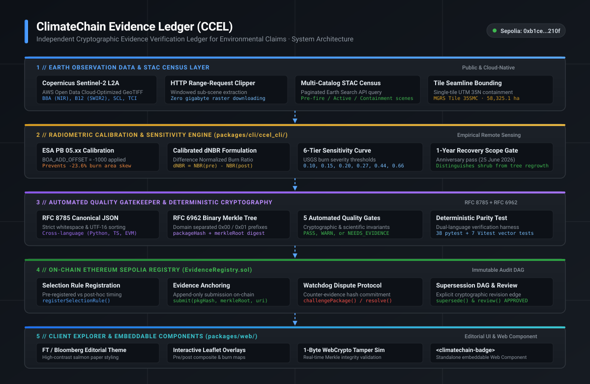
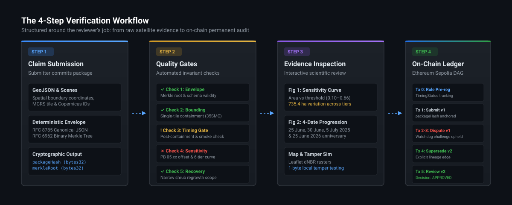
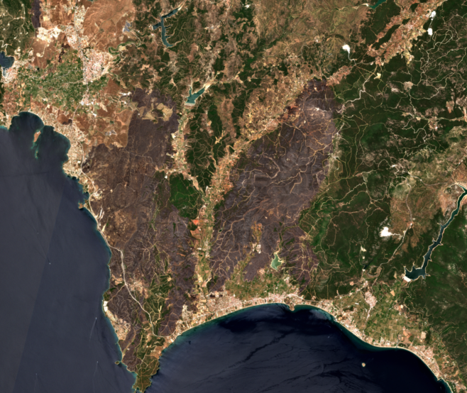
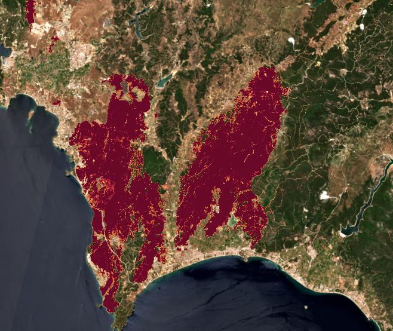
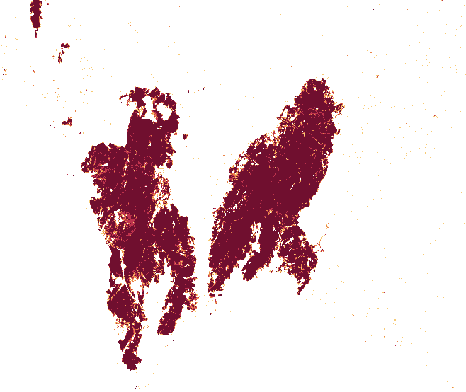

# ClimateChain Evidence Ledger (CCEL)

[](https://sepolia.etherscan.io/address/0xb1ce2e8ceb392ad3bf0e011d05689058dfa9210f)
[](https://sepolia.etherscan.io/address/0xb1ce2e8ceb392ad3bf0e011d05689058dfa9210f)
[](https://www.rfc-editor.org/rfc/rfc8785)
[](https://www.rfc-editor.org/rfc/rfc6962)
[](LICENSE-APACHE)

> **Product:** Independent Cryptographic Evidence Verification Ledger for Environmental Claims  
> **Supported Module:** Sentinel-2 L2A Wildfire Disturbance & Recovery Analysis (MGRS Tile `35SMC`, UTM 35N)  
> **Anchor Investigation Case:** June 2025 İzmir / Orhanlı Wildfires (Seferihisar & Menderes, İzmir, Türkiye)  
> **Core Product Question:** *"How much land appears burned, how sensitive is that estimate to the imagery and method, and can another reviewer reproduce it?"*  
> **Live Sepolia Registry Contract:** [`0xb1ce2e8ceb392ad3bf0e011d05689058dfa9210f`](https://sepolia.etherscan.io/address/0xb1ce2e8ceb392ad3bf0e011d05689058dfa9210f)  
> **Web Application:** `http://127.0.0.1:5173/` (FT / Bloomberg high-contrast editorial theme)

---

## System Architecture



---

## Quickstart

Run the complete 6-stage verification suite (Secret & Licence guard, Python CLI & geospatial tests, Foundry smart contract tests + fuzzing, TypeScript web tests, static production build, CLI evidence package verification, and deep on-chain Ethereum Sepolia RPC state verification) in a single command:

```bash
./scripts/verify_all.sh
```

To run the interactive web verifier application locally:
```bash
npm --prefix packages/web run dev
# Open http://127.0.0.1:5173/ in your browser
```

To recompute the empirical Sentinel-2 dNBR wildfire analysis directly from AWS Open Data Copernicus COGs via HTTP Range requests:
```bash
PYTHONPATH=packages/cli ./.venv/bin/python packages/cli/ccel_cli/izmir_dnbr.py
```

---

## 1. Product Paradigm: Submit an Environmental Claim for Review

Most environmental, carbon, and damage assessments circulate as static, opaque PDF reports. Reviewers, auditors, and buyers are presented with a single headline number, while critical scientific parameters remain unrecorded:
- Was the satellite observation acquired while fires or clouds were actively obscuring the terrain?
- Did the perimeter expand after the satellite overpass?
- What burn-severity threshold was applied, and how sensitive is the estimated area to that threshold?
- Was radiometric baseline calibration applied (e.g. ESA Processing Baseline 05.xx offsets)?
- If recovery is claimed 1 year later, is it natural shrub greening or true restored tree canopy?

**ClimateChain Evidence Ledger (CCEL)** replaces opaque reports with an **independent evidence verification tool** structured around the reviewer's job:



1. **Step 1 // Claim Submission:** The submitter commits GeoJSON/WKT AoI, Copernicus scene IDs, and radiometric metrics into an RFC 8785 canonical JSON envelope and RFC 6962 binary Merkle tree.
2. **Step 2 // Automated Quality Gatekeeper:** Evaluates cryptographic envelope integrity, study area single-tile containment (58,325.1 ha on tile `35SMC`, avoiding mosaic seamlines), observation timing & smoke coverage, radiometric calibration offsets, and longitudinal recovery limits. Clearly surfaces *what was checked* vs. *what needs more evidence*.
3. **Step 3 // Detailed Evidence Inspection:** Interactive threshold sensitivity curve and table across 6 USGS tiers (0.10 to 0.66), 4-panel multi-date satellite progression, and Leaflet map with calibrated dNBR overlays.
4. **Step 4 // On-Chain Sepolia Ledger:** Permanent dispute and review history, 1-byte WebCrypto tamper simulator, and embeddable `<climatechain-badge>` Web Component.

> **Modular Architecture:** CCEL is designed as a modular evidence verification ledger. This module implements the end-to-end pipeline for **Sentinel-2 L2A Wildfire Disturbance & Recovery Analysis (MGRS Tile 35SMC)**. Arbitrary text documents without spatial and radiometric coordinates cannot bypass the automated quality gates.

---

## 2. Remote Sensing Evidence & Visual Grounding

| True Color Observation (5 July 2025) | False Color SWIR/NIR Composite (B12/B8A/B04) | Calibrated dNBR Burn Severity Overlay |
| :---: | :---: | :---: |
|  |  |  |
| *Sentinel-2 TCI RGB overpass capturing post-containment terrain* | *SWIR/NIR composite highlighting high-severity charcoal & ash* | *Calibrated dNBR overlay with ESA PB 05.xx offset applied* |

---

## 3. Anchor Investigation: June 2025 İzmir / Orhanlı Wildfires

To ground the verification engine in real-world environmental auditing, CCEL includes a verified benchmark of the **June 2025 Orhanlı / Seferihisar wildfires in İzmir, Türkiye** ([NERO Research Brief](https://nero-network.eu/wp-content/uploads/2025/07/202501_NERO_Fire_Brief_2025_Turkiye_Izmir_Orhanli_01_07_Final-1.pdf) by Dr. Coskuner & Dr. Papavasileiou, 1 July 2025).

### Empirical Findings:
1. **Preliminary Report Bracketing:** NERO published preliminary estimates of **4,277.7 ha** (Fire A — Orhanlı/Menderes) and **3,541.9 ha** (Fire B — Seferihisar/Doğanbey) totaling **7,819.6 ha** based on 30 June imagery. CCEL's independent calibrated dNBR pipeline yields **7,808.6 ha** at `dNBR >= 0.20` (Fire A: 4,144.0 ha, Fire B: 3,664.6 ha), bracketing NERO's combined figure within **0.14%**.
2. **Timing & Post-Overpass Fire Spread:** The 30 June 08:56 UTC overpass captured active burning with **1,957.5 ha** obscured by active smoke and dark char (SCL classes 2 & 7). Subsequent clear imagery on 5 July 2025 reveals that the fire expanded by **+1,917.6 ha (+24.6%)** to **9,726.2 ha**, driven by Fire B in Seferihisar expanding from 3,664.6 ha to 5,105.6 ha.
3. **Threshold Sensitivity:** Depending on whether a conservative threshold (`dNBR >= 0.27`) or permissive threshold (`dNBR >= 0.15`) is chosen, estimated burned area swings by **735.4 ha** on 30 June and **669.9 ha** on 5 July. Single-number figures are meaningless without publishing the sensitivity curve.
4. **Radiometric Calibration Offset:** Omitting ESA Processing Baseline 05.xx `BOA_ADD_OFFSET = -1000` causes uncalibrated scripts to underestimate moderate-to-high severity (`dNBR >= 0.44`) by **-1,703.6 ha (-23.6%)**.
5. **Exact 1-Year Follow-Up (25 June 2026):** Sentinel-2C overpass on the exact 1-year calendar anniversary reveals that **6,842.4 ha** remain persistent burn scar (`dNBR >= 0.20`), while **2,883.8 ha** exhibit early spectral rebound (mean NBR over the burned scar `dNBR >= 0.20` shifted from -0.6205 on 5 July 2025 to +0.1619 on 25 June 2026, vs. +0.6386 pre-fire). The gatekeeper strictly enforces the narrow limitation: **spectral greening is early shrub/herbaceous resprouting, NOT proof of tree replanting or carbon recovery.**

---

## 4. Automated Quality Gatekeeper: v1 vs. v2 Comparison

| Quality Gate | Package v1 (Provisional Claim) | Package v2 (Reproducible Package) |
| :--- | :--- | :--- |
| **Check 1: Cryptographic Envelope** | **PASS** — Canonical JSON & Merkle root valid | **PASS** — Canonical JSON & Merkle root valid |
| **Check 2: Study Area Bounding** | **PASS** — 58,325.1 ha on tile 35SMC; avoids mosaic seamlines (residual date-to-date differences remain) | **PASS** — 58,325.1 ha on tile 35SMC; avoids mosaic seamlines (residual date-to-date differences remain) |
| **Check 3: Satellite Census Timing** | **WARN (RATIONALE REQUESTED)** — Relies solely on active-fire June 30 pass; 1,957.5 ha smoke obscured; omits July 5 pass | **PASS (APPROVED)** — Discloses 30 June active fire separate from 5 July contained (+1,917.6 ha spread captured) |
| **Check 4: Threshold & Calibration Gate** | **FAIL (NEEDS EVIDENCE)** — Reports single-point 7,808 ha without sensitivity curve or PB 05.xx offset | **PASS (APPROVED)** — Publishes full 6-tier curve (0.10–0.66) and PB 05.xx offset calibration |
| **Check 5: 1-Year Recovery Gate** | **WARN (NOT INCLUDED)** — Lacks follow-up | **PASS (APPROVED)** — Includes 25 June 2026 pass; enforces narrow non-carbon scope |
| **Overall Gatekeeper Decision** | `NEEDS_EVIDENCE / RATIONALE_REQUESTED` | `APPROVED` |

---

## 5. Live Ethereum Sepolia Audit Trail (`chainId: 11155111`)

Every submission, dispute, adjudication, and supersession is permanently anchored on Ethereum Sepolia:

> **Testnet Architecture Disclosure:** The Submitter, Independent Wildfire Auditor, and Lead Verification Reviewer roles operate as distinct cryptographic actor accounts on the Sepolia testnet to execute and demonstrate the full protocol lifecycle.

| Step / Transaction | Action & On-Chain Status | Transaction Hash | Etherscan Link |
| :--- | :--- | :--- | :--- |
| **EvidenceRegistry Contract** | Active Deployment v2 | `0xb1ce2e8ceb392ad3bf0e011d05689058dfa9210f` | [View Contract](https://sepolia.etherscan.io/address/0xb1ce2e8ceb392ad3bf0e011d05689058dfa9210f) |
| **Tx 0: Register Selection Rule** | `TimingStatus.POST_HOC` | `0xff795fd663f993e53b634d11c335b58825ac96a52de34f2b122d67b9d9ffa5a4` | [View Tx](https://sepolia.etherscan.io/tx/0xff795fd663f993e53b634d11c335b58825ac96a52de34f2b122d67b9d9ffa5a4) |
| **Tx 1: Submit Package v1** | `0x40301773...` (Provisional Claim) | `0x6eac30f77dd46a82c66642adbe8214323b0167e573a3bf2760970742470d7b75` | [View Tx](https://sepolia.etherscan.io/tx/0x6eac30f77dd46a82c66642adbe8214323b0167e573a3bf2760970742470d7b75) |
| **Tx 2: Watchdog Dispute v1** | `CHALLENGED` (Incomplete Timing & Smoke) | `0x1b948e2fe6588cf0c6ffcc36b0552b3ae2decc2f77a17cb1e88e7f5f88be994e` | [View Tx](https://sepolia.etherscan.io/tx/0x1b948e2fe6588cf0c6ffcc36b0552b3ae2decc2f77a17cb1e88e7f5f88be994e) |
| **Tx 3: Resolve Challenge v1** | Upheld ➔ `NEEDS_EVIDENCE` | `0x821a9add721055e9c921d8ee91ff73b20719cb3ca530bbd51d9bcc82634c9961` | [View Tx](https://sepolia.etherscan.io/tx/0x821a9add721055e9c921d8ee91ff73b20719cb3ca530bbd51d9bcc82634c9961) |
| **Tx 4: Supersede v1 -> v2** | `0xc19fd3bb...` (Reproducible Package) | `0x784121e3db0bcade22a40a8cb32e001611bf998d92c8b356edc6925415e5bdf6` | [View Tx](https://sepolia.etherscan.io/tx/0x784121e3db0bcade22a40a8cb32e001611bf998d92c8b356edc6925415e5bdf6) |
| **Tx 5: Review Package v2** | `APPROVED` (`ALL_CHECKS_PASSED`) | `0xa266cd1037fe3ab2ba0f5e91ac3056ceb647eaea7aaf5e52c86e805548508f35` | [View Tx](https://sepolia.etherscan.io/tx/0xa266cd1037fe3ab2ba0f5e91ac3056ceb647eaea7aaf5e52c86e805548508f35) |

---

## 6. Repository Architecture

```
packages/
├── cli/                 # Python Verification CLI & Empirical dNBR Engine
│   ├── ccel_cli/
│   │   ├── izmir_dnbr.py     # Sentinel-2 L2A COG dNBR & sensitivity calculator
│   │   ├── census.py         # Multi-catalog paginated STAC census engine
│   │   ├── builder.py        # RFC 8785 canonical manifest builder
│   │   ├── checks.py         # Automated evaluation quality gates
│   │   └── canonical.py      # RFC 6962 binary Merkle tree & JCS hasher
│   └── tests/                # 38 pytest unit tests (100% passing)
├── contracts/           # Foundry Ethereum Smart Contracts
│   ├── src/
│   │   ├── EvidenceRegistry.sol  # Append-only DAG with TimingStatus & challenges
│   │   └── IEvidenceRegistry.sol # Interface, structs, and events
│   └── test/
│       └── EvidenceRegistry.t.sol # 18 Foundry unit tests + property fuzzing
└── web/                 # FT / Bloomberg Editorial Web Verifier
    ├── src/
    │   ├── main.ts              # 4-step verification workflow controller
    │   ├── styles/editorial.css # High-contrast salmon paper & ink design system
    │   ├── components/          # Embeddable <climatechain-badge> Web Component
    │   └── services/            # Viem Sepolia RPC client & check engine
    └── public/fixtures/         # Verified audit fixtures & dNBR rasters
```

---

## 7. Key Verification Commands

```bash
# Run full verification (6 stages)
./scripts/verify_all.sh

# Run Foundry tests with fuzzing
~/.foundry/bin/forge test --root packages/contracts

# Run Python test suite
PYTHONPATH=packages/cli ./.venv/bin/pytest packages/cli/tests

# Run Web Vitest test suite
npm --prefix packages/web test

# Recompute İzmir dNBR rasters & sensitivity metrics from AWS Open Data
PYTHONPATH=packages/cli ./.venv/bin/python packages/cli/ccel_cli/izmir_dnbr.py
```

---

## 8. Technical Specifications & Security Documentation

- **[System Architecture & Technical Specification](docs/ARCHITECTURE_AND_SPEC.md):** Detailed cryptographic, remote sensing, and smart contract protocol specifications.
- **[Security & Data Integrity Invariants](docs/SECURITY_AND_DATA_INTEGRITY.md):** Formal invariants, threat model, license protection, and anti-griefing guarantees.
