# ClimateChain Evidence Ledger (CCEL): Architecture & Technical Specification

> **Product:** Independent Cryptographic Evidence Verification Ledger for Environmental Claims  
> **Supported Prototype Module:** Sentinel-2 L2A Wildfire Disturbance & Recovery Analysis (MGRS Tile `35SMC`, UTM 35N)  
> **Anchor Investigation:** June 2025 İzmir / Orhanlı Wildfires (Seferihisar & Menderes, Türkiye)  
> **Live Sepolia Registry Contract:** [`0xb1ce2e8ceb392ad3bf0e011d05689058dfa9210f`](https://sepolia.etherscan.io/address/0xb1ce2e8ceb392ad3bf0e011d05689058dfa9210f)

---

## 1. System Overview & The 4-Step Verification Workflow

CCEL is engineered to replace trust-based PDF environmental reports with an interactive, mathematically rigorous evidence verifier:

```mermaid
flowchart TD
    subgraph Step1["Step 1 // Claim & Evidence Package Submission"]
        P1["Submitter Packages GeoJSON/WKT AoI, Scene IDs, & Radiometric Metrics"]
        P2["Canonical Envelope Construction: RFC 8785 (JCS) + RFC 6962 Domain-Separated Merkle Tree"]
    end

    subgraph Step2["Step 2 // Automated Quality Gatekeeper"]
        G1["Check 1: Cryptographic Envelope & Merkle Leaf Integrity"]
        G2["Check 2: Study Area Bounding & Single-Tile Seamline Integrity (35SMC)"]
        G3["Check 3: Multi-Catalog Census Completeness & Timing Gate"]
        G4["Check 4: Radiometric Calibration (PB 05.xx) & Threshold Sensitivity Gate"]
        G5["Check 5: 1-Year Vegetation Recovery Limitation Gate (Non-Carbon Scope)"]
    end

    subgraph Step3["Step 3 // Detailed Evidence Inspection"]
        E1["Figure 1: dNBR Burn Severity Sensitivity Curve & Sector Split Table"]
        E2["Figure 2: Multi-Temporal Sentinel-2 Progression (25 June, 30 June, 5 July, 25 June 2026)"]
        E3["Interactive Leaflet Map with Calibrated dNBR Raster Overlays"]
    end

    subgraph Step4["Step 4 // On-Chain Sepolia Ledger & Dispute Resolution"]
        C1["registerSelectionRule: TimingStatus (PRE_REGISTERED vs POST_HOC)"]
        C2["submit: Anchors packageHash & Merkle Root"]
        C3["challengePackage: Watchdog Dispute Protocol (Counter-Evidence Hash)"]
        C4["resolveChallenge & supersede: Upheld challenge forces reproducible v2"]
        C5["review: Authorized Auditor Decision (APPROVED / NEEDS_EVIDENCE)"]
    end

    P1 --> P2
    P2 --> Step2
    Step2 --> Step3
    Step3 --> Step4
```



---

## 2. Cryptographic Specification

### 2.1 RFC 8785 JSON Canonicalization Scheme (JCS)
To ensure identical hash outputs across Python CLI, Go backend services, and TypeScript web browsers:
1. **UTF-8 Encoding:** All JSON documents are encoded strictly in UTF-8 without Byte Order Marks (BOM).
2. **Whitespace Stripping:** Zero whitespace outside string literals (separators `,` and `:` without trailing/leading spaces).
3. **Lexicographical Key Sorting:** Object keys are sorted strictly by UTF-16 code units.
4. **Float Normalization:** Floating-point numbers are formatted using ECMAScript `Number.prototype.toString()` specification. `-0.0` is normalized to `0`. `NaN` and `Infinity` are rejected.

### 2.2 RFC 6962 Domain-Separated Binary Merkle Tree
To prevent second-preimage collision attacks:
* **Leaf Hashing:**
  $$\text{Leaf}_i = \text{SHA256}(\texttt{0x00} \parallel \text{UTF8}(\text{leafId}) \parallel \texttt{0x00} \parallel \text{RFC8785\_Bytes}(\text{leafPayload}))$$
* **Internal Node Hashing:**
  $$\text{Node}_{L,R} = \text{SHA256}(\texttt{0x01} \parallel \text{Hash}_L \parallel \text{Hash}_R)$$
* **Odd-Node Promotion:** When a tree level has an odd node count $2k + 1$, node $2k$ is promoted directly to the next level without hashing (RFC 6962 Section 2.1.1).
* **Package Hash & Report Hash:**
  $$\text{packageHash} = \text{SHA256}(\text{RFC8785\_Bytes}(\texttt{manifest.commitment}))$$
  $$\text{reportHash} = \text{SHA256}(\text{RFC8785\_Bytes}(\texttt{report.commitment}))$$

---

## 3. Remote Sensing & Calibrated dNBR Formulation

### 3.1 Study Area & Single-Tile Architecture
* **Study Area:** Seferihisar (West / Fire B) and Orhanlı–Menderes (East / Fire A), İzmir Province, Türkiye.
* **Bounding Box (WGS84):** `[26.78°E, 38.03°N, 27.08°E, 38.23°N]`
* **Total Study Area Extent:** **58,325.1 ha** (1,108 rows × 1,316 cols × 0.04 ha/pixel at 20m)
* **UTM Projection:** UTM Zone 35N (EPSG:32635)
* **MGRS Tile:** `35SMC` (Origin: $X=400000, Y=4300000$).
* **Single-Tile Scope:** The entire study area is contained within Sentinel-2 tile `35SMC`. This avoids spatial mosaic seamlines and cross-tile stitching within the study area; residual date-to-date atmospheric and viewing-geometry variations remain across different acquisition dates.

### 3.2 Normalized Burn Ratio (NBR) and Difference NBR (dNBR)
$$\text{NBR} = \frac{\rho_{B8A} - \rho_{B12}}{\rho_{B8A} + \rho_{B12}}$$
$$\text{dNBR} = \text{NBR}_{\text{pre-fire}} - \text{NBR}_{\text{post-fire}}$$

Where:
- $\rho_{B8A}$ is Narrow Near-Infrared (Sentinel-2 Band 8A, central wavelength $\approx 865\text{ nm}$, 20m resolution).
- $\rho_{B12}$ is Shortwave Infrared-2 (Sentinel-2 Band 12, central wavelength $\approx 2190\text{ nm}$, 20m resolution).

### 3.3 ESA Processing Baseline 05.xx Calibration Offset
Starting with ESA Processing Baseline `04.00` and `05.xx` (in effect across 2024–2026), L2A surface reflectance digital numbers (DN) include a fixed additive offset:
$$\text{BOA\_ADD\_OFFSET} = -1000$$
$$\rho_{\text{surface}} = \frac{\text{DN} + \text{BOA\_ADD\_OFFSET}}{10000.0} = \frac{\text{DN} - 1000}{10000.0}$$

**Audit Finding:** Omitting this offset produces severe distortion in low-reflectance burn pixels, causing uncalibrated pipelines to underestimate moderate-to-high severity burned area by **-1,703.6 ha (-23.6%)**.

---

## 4. Smart Contract Architecture (Ethereum Sepolia)

```solidity
contract EvidenceRegistry is IEvidenceRegistry {
    // 1. Immutable append-only DAG of evidence packages
    mapping(bytes32 => EvidencePackage) public packages;

    // 2. Cryptographic lineage tracking supersession edges
    mapping(bytes32 => bytes32) public supersededBy;

    // 3. Selection rules with timing status (PRE_REGISTERED vs POST_HOC)
    mapping(bytes32 => SelectionRule) public rules;

    // 4. Watchdog challenge records with counter-evidence hashes
    mapping(bytes32 => Dispute[]) public disputes;

    // 5. Authorized reviewer audit decisions
    mapping(bytes32 => ReviewDecision[]) public reviews;
}
```

### Protocol Invariants:
1. **DAG Immutability:** Packages cannot be overwritten or deleted. Revisions create explicit supersession edges (`supersede(newPackageHash, prevPackageHash, ...)`).
2. **Anti-Griefing Protection:** Only the original package submitter can register a superseding version, preventing unauthorized hijacking.
3. **Counter-Report Binding:** Watchdog disputes require committing a `counterReportHash` on-chain, preventing spam challenges without verifiable evidence.
4. **Honest Timing Attribution:** Selection rules registered after the start of a monitoring window are irrevocably flagged as `POST_HOC`.

### 4.1 Testnet Deployment Accounts Disclosure
For this Ethereum Sepolia deployment, the Submitter, Independent Wildfire Auditor, and Lead Verification Reviewer roles operate as distinct demonstration cryptographic accounts to execute and verify the full protocol lifecycle. In production, these roles map to distinct institutional actors (project submitters, third-party watchdogs, and accredited validation/verification bodies).
